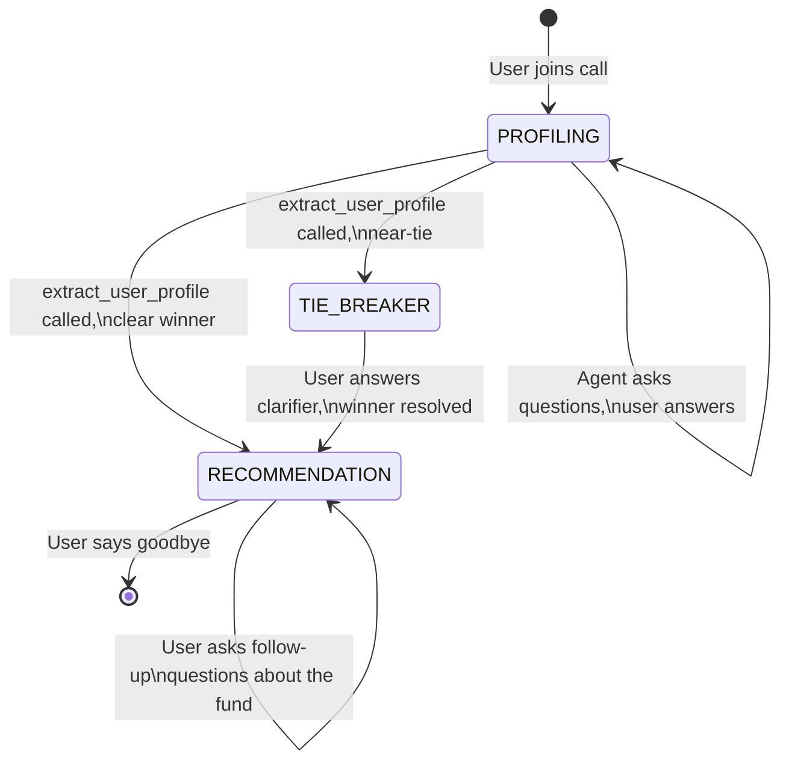

# Implementation Plan: Mutual Fund Voice Agent

Build a Pipecat voice agent that profiles users through 3-5 conversational questions, recommends one of 3 PPFAS mutual fund schemes via a deterministic scoring engine, then answers follow-up questions using in-context knowledge from the fund documents.

## User Review Required

> [!IMPORTANT]
> **Transport Layer**: The reference pipeline uses **Daily WebRTC** which requires a Daily.co account and a server component. For a simpler demo setup, I plan to use **Pipecat's local transport** (microphone/speaker on your machine) for development, with Daily as an optional upgrade. Is that acceptable?

> [!IMPORTANT]
> **LLM Choice**: I'll wire up **Gemini 2.0 Flash** (`gemini-2.0-flash`) via `pipecat.services.google.llm.GoogleLLMService` on the free tier. If latency is poor during testing, we can swap to Groq. Agreed?

> [!WARNING]
> **Free Tier Limits**: Deepgram free tier gives ~45 min/month of STT. I'll build a **text-mode testing harness** (terminal input/output, no STT/TTS) so you can develop and test without burning voice minutes. Voice mode is only for final demos.

## Open Questions

1. **Daily.co account**: Do you have a Daily.co API key, or should we stick with local transport (mic/speaker) for the demo?
2. **Cartesia voice**: Any preference for a specific voice ID, or should I pick a professional Indian English voice?
3. **Deployment**: Is this a local demo only, or will you deploy it somewhere (e.g., a web app with Daily)?

---

## Proposed Changes

### Project Structure

```
mf_agent/
├── .env                    # API keys (GOOGLE_API_KEY, DEEPGRAM_API_KEY, CARTESIA_API_KEY)
├── requirements.txt        # Python dependencies
├── bot.py                  # Main entry point — builds and runs the Pipecat pipeline
├── scoring.py              # Deterministic soft-scoring recommendation engine
├── prompts.py              # System prompts for each conversation state
├── knowledge_base.py       # Loads the 6 MD files, provides per-scheme context
├── text_bot.py             # Text-mode testing harness (no STT/TTS, terminal I/O)
├── tasks.md                # Trackable task list
├── docs/
│   └── gemini_suggestion_for_decision_tree.md
├── Dfly.md, Dpres.md       # Dynamic Asset Allocation fund docs
├── FCfly.md, FCpres.md     # Flexi Cap fund docs
├── LCfly.md, LCpres.md     # Large Cap fund docs
└── venv/                   # Python virtual environment
```

---

### Core Components

#### [NEW] [requirements.txt](file:///home/op/projects/mf_agent/requirements.txt)

Minimal dependencies:
```
pipecat-ai[google,deepgram,cartesia,silero,daily]
python-dotenv
loguru
```

---

#### [NEW] [knowledge_base.py](file:///home/op/projects/mf_agent/knowledge_base.py)

Loads all 6 markdown files at startup into a dictionary keyed by scheme ID. Provides two functions:

- `get_scheme_context(scheme_id: str) -> str` — Returns the combined flyer + presentation markdown for a specific scheme (injected into the system prompt during Q&A state).
- `get_comparison_table() -> str` — Returns the hardcoded comparison table (exit loads, minimums, TER, inception dates) for cross-fund comparison questions.

```python
SCHEME_FILES = {
    "Dynamic_Asset_Allocation": ["Dfly.md", "Dpres.md"],
    "Large_Cap": ["LCfly.md", "LCpres.md"],
    "Flexi_Cap": ["FCfly.md", "FCpres.md"],
}
```

All files are read once at startup and held in memory (~90KB total). No vector DB needed.

---

#### [NEW] [scoring.py](file:///home/op/projects/mf_agent/scoring.py)

The deterministic recommendation engine. Contains:

- `recommend_mutual_fund(profile: dict) -> dict` — Takes the structured profile from Gemini's function call, runs the soft-scoring rules (horizon, risk, style, investment amount), returns:
  ```python
  {
      "winner": "Flexi_Cap",           # or "Dynamic_Asset_Allocation" / "Large_Cap"
      "scores": {"Dynamic_Asset_Allocation": 3, "Large_Cap": 7, "Flexi_Cap": 11},
      "is_tie": False,                  # True if top two within 1 point
      "runner_up": "Large_Cap",         # second place (for tie-breaker)
      "profile_summary": "5+ year horizon, high risk tolerance, prefers global diversification"
  }
  ```

Uses the refined scoring engine from our review (with exit load penalties, fund age weighting, near-tie detection).

---

#### [NEW] [prompts.py](file:///home/op/projects/mf_agent/prompts.py)

Three system prompts, one per conversation state:

**`PROFILING_PROMPT`** — The agent's personality + instructions to gather investment profile:
```
You are a friendly mutual fund advisor voice agent for PPFAS Mutual Fund.
Your goal is to help the user find the right mutual fund scheme by asking
3-4 conversational questions about:
1) Their investment timeframe (how many years)
2) Their comfort with market volatility (risk tolerance)  
3) How much they want to invest initially (in Rupees)
4) Whether they prefer stability or growth (investment style) — ask this
   naturally based on their earlier answers

Ask ONE question at a time. Be warm, conversational, and brief — this is
a voice call, not a text chat. Keep responses under 2-3 sentences.

DO NOT mention specific fund names yet. DO NOT read disclaimers yet.

Once you have enough information, call the `extract_user_profile` tool.

MANDATORY DISCLAIMER at the START of the conversation:
"Please note that I am an AI assistant and not a registered financial
advisor. My suggestions are for informational purposes only."
```

**`RECOMMENDATION_PROMPT_TEMPLATE`** — Template string, populated with the winning scheme's knowledge base + profile summary:
```
The system has matched the user with {fund_name}.

MANDATORY FIRST ACTION: Read this disclaimer verbatim:
"Mutual Fund investments are subject to market risks, read all scheme
related documents carefully."

Then enthusiastically explain which fund they matched with and WHY,
based on their profile: {profile_summary}

After the explanation, ask if they have any questions about the fund.

CRITICAL RULES:
- ONLY use facts from the knowledge base below. NEVER invent numbers.
- If asked something not in the knowledge base, say: "I don't have that
  specific detail. I'd recommend checking the fund's official factsheet
  at amc.ppfas.com or speaking with a financial advisor."
- When citing performance data, always mention the time period.
- {fund_name} was launched on {inception_date}. If it has less than 1
  year of history, acknowledge this when discussing performance.

=== KNOWLEDGE BASE ===
{scheme_context}
=== END KNOWLEDGE BASE ===
```

**`TIE_BREAKER_PROMPT`** — For near-tie scenarios, asks one clarifying question to distinguish between the two contenders.

---

#### [NEW] [bot.py](file:///home/op/projects/mf_agent/bot.py)

The main Pipecat pipeline. Simplified from your reference [pipeline.py](file:///home/op/projects/mf_agent/pipeline.py):

**What we keep from the reference:**
- Pipeline structure: `transport.input() → stt → user_aggregator → llm → tts → transport.output() → assistant_aggregator`
- `FunctionSchema` / `ToolsSchema` pattern for function calling
- `LLMContext` + `LLMContextAggregatorPair` for conversation history
- `SileroVADAnalyzer` for voice activity detection
- Basic `loguru` logging (session start, tool calls, latency)
- `on_first_participant_joined` / `on_participant_left` event handlers

**What we drop:**
- `TimedOpenAILLMService` / `TimedCartesiaTTSService` / `TimedDeepgramSTTService` (no HTTP timing subclasses)
- `PIIRedactionFrameProcessor` (no PII in mutual fund conversations)
- All clinic-specific tool handlers (`select_patient`, `book_appointment`, etc.)
- `UserBotLatencyObserver`, `TurnTrackingObserver`, `LLMLogObserver`, `TranscriptionLogObserver`, `MetricsLogObserver` (keep only `MetricsLogObserver` for basic TTFB tracking)
- Prompt cache warming (`_warm_cache`)

**What we add:**
- **State machine** with 3 states: `PROFILING`, `RECOMMENDATION`, `TIE_BREAKER`
- **`extract_user_profile` tool handler** — When Gemini calls this tool:
  1. Parse the structured profile arguments
  2. Run `scoring.recommend_mutual_fund(profile)`
  3. If tie → transition to `TIE_BREAKER` state, update system prompt
  4. If clear winner → transition to `RECOMMENDATION` state, inject scheme KB into system prompt
  5. Return the recommendation result to the LLM so it can announce it
- **Dynamic system prompt updates** — On state transition, update `context.messages[0]` (the system message) with the new prompt + injected knowledge base
- **`GoogleLLMService`** instead of `OpenAILLMService`

**Simplified pipeline diagram:**
```
┌─────────┐   ┌─────────┐   ┌──────────────┐   ┌───────────────┐   ┌─────┐   ┌──────────┐   ┌──────────────────┐
│Transport│──▶│Deepgram │──▶│User          │──▶│Gemini Flash   │──▶│Cart-│──▶│Transport │──▶│Assistant         │
│ Input   │   │  STT    │   │Aggregator    │   │(+func calling)│   │esia │   │ Output   │   │Aggregator        │
└─────────┘   └─────────┘   └──────────────┘   └───────┬───────┘   └─────┘   └──────────┘   └──────────────────┘
                                                        │
                                                        ▼ (on extract_user_profile call)
                                                ┌───────────────┐
                                                │  scoring.py   │
                                                │  (local, no   │
                                                │   API call)   │
                                                └───────────────┘
```

---

#### [NEW] [text_bot.py](file:///home/op/projects/mf_agent/text_bot.py)

A terminal-based testing harness that bypasses Deepgram/Cartesia entirely:
- Uses `stdin` for user input and `stdout` for bot output
- Same LLM (Gemini), same scoring engine, same knowledge base
- Lets you test the full conversation flow without burning STT/TTS free-tier minutes
- Useful for: prompt engineering, scoring validation, edge case testing

---

#### [NEW] [.env](file:///home/op/projects/mf_agent/.env)

```env
GOOGLE_API_KEY=your_gemini_api_key_here
DEEPGRAM_API_KEY=your_deepgram_api_key_here
CARTESIA_API_KEY=your_cartesia_api_key_here
DAILY_API_KEY=your_daily_api_key_here  # optional, only for Daily transport
```

---

### State Machine Flow



---

## Verification Plan

### Automated Tests
```bash
# 1. Test scoring engine with edge cases
python -m pytest tests/test_scoring.py -v

# 2. Run text-mode bot for full conversation flow testing
python text_bot.py
```

### Manual Verification
1. **Text mode first**: Run `text_bot.py`, simulate 5+ different user profiles (short-horizon/low-risk, long-horizon/high-risk, ambiguous answers, tie scenarios) and verify:
   - Correct fund is recommended each time
   - Agent doesn't hallucinate fund details
   - Disclaimer is spoken at the right times
   - Knowledge base answers are accurate
2. **Voice mode**: Run `bot.py`, join the Daily room (or use local mic), and verify:
   - STT accurately captures speech
   - TTS sounds natural and not robotic
   - Latency is acceptable (target < 2s end-to-end)
   - Interruption handling works (user can cut in while bot is talking)
3. **Edge cases to test**:
   - User says "I don't know" to risk tolerance question
   - User gives contradictory answers ("I want safety but also maximum returns")
   - User asks about a scheme that wasn't recommended
   - User asks about performance of Large Cap (which has no track record)
   - User wants to invest less than ₹5,000 (disqualifies Dynamic)
