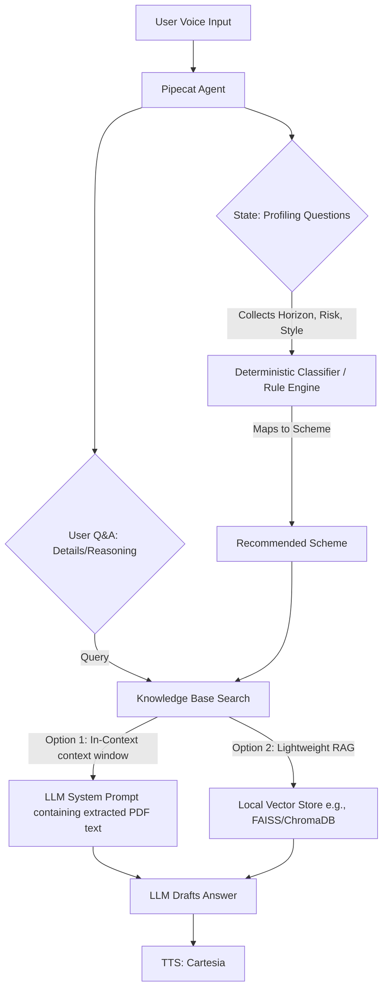

# Brainstorm: Mutual Fund Recommending Voice Agent

This document outlines the strategic and architectural brainstorming for building a voice-based mutual fund recommendation agent.

---

## 1. User Profiling Questions (Determining the Recommendation)
To guide a user to one of the **3 schemes** (Dynamic Asset Allocation, Large Cap, Flexi Cap) and help them make an informed decision, the voice agent should ask a maximum of 3-4 natural questions to keep the voice interaction engaging and prevent user fatigue.

### Core Questions to Ask:
1. **Investment Horizon (Timeframe):**
   * *Question:* "How long are you planning to keep this money invested? Are we looking at a short term of 1 to 3 years, or a longer term of 5 or more years?"
   * *Purpose:* Immediately distinguishes between schemes that hold debt for stability (Dynamic/Balanced Advantage) and pure equity schemes (Large Cap/Flexi Cap) which require a longer timeframe to ride out market cycles.
2. **Risk Tolerance & Downside Comfort:**
   * *Question:* "If the stock market took a temporary downturn and your investment value dropped by 10-15%, how would you feel? Would you want a fund that automatically protects you from the downside, or are you comfortable with volatility in exchange for higher long-term growth?"
   * *Purpose:* Maps conservative/moderate investors to Dynamic Asset Allocation (which dynamically shifts between equity and debt based on market valuations) and aggressive investors to pure equity (Large Cap/Flexi Cap).
3. **Growth Style (Stable Blue-Chips vs. Dynamic Diversification):**
   * *Question:* (If they prefer long-term/equity): "Do you prefer investing in top-100 established market leaders (blue-chips) for stable growth, or do you want a dynamic mix of large, mid, and small companies that can adapt to changing market opportunities?"
   * *Purpose:* Maps to Large Cap (stable blue-chips) vs. Flexi Cap (dynamic multi-cap exposure).

### Summary Mapping Matrix:
| Investment Horizon | Risk Profile | Growth Style | Recommended Scheme | Rationale |
| :--- | :--- | :--- | :--- | :--- |
| **Short-Medium (1-3 yrs)** | Low to Moderate | Protection first | **Dynamic Asset Allocation** | Balances debt and equity to protect downside. Good for shorter horizons. |
| **Long-Term (5+ yrs)** | Moderate | Stable Growth | **Large Cap** | Invests in top 100 blue-chips. High equity exposure but lower volatility than mid/small caps. |
| **Long-Term (5+ yrs)** | High | Maximum Growth / Dynamic | **Flexi Cap** | Can invest across all market caps (large, mid, small) dynamically to maximize returns. |

### Concrete JSON Rule Schema & Local Decision Tree
To implement the recommendation flow deterministically, you can structure a simple Python classifier script.

#### 1. The Scheme Meta JSON File (`schemes_config.json`)
This defines the decision boundaries extracted from the PDFs:
```json
{
  "schemes": [
    {
      "id": "dynamic_asset_allocation",
      "name": "Dynamic Asset Allocation Fund",
      "criteria": {
        "min_horizon_years": 1,
        "max_horizon_years": 3,
        "risk_tolerance": ["low", "moderate"],
        "investment_style": "downside_protection"
      }
    },
    {
      "id": "large_cap",
      "name": "Large Cap Fund",
      "criteria": {
        "min_horizon_years": 5,
        "risk_tolerance": ["moderate", "high"],
        "investment_style": "stable_growth"
      }
    },
    {
      "id": "flexi_cap",
      "name": "Flexi Cap Fund",
      "criteria": {
        "min_horizon_years": 5,
        "risk_tolerance": ["high"],
        "investment_style": "aggressive_growth"
      }
    }
  ]
}
```

#### 2. Local Decision Tree Logic (Python Classifier)
When the user answers the 3-5 profiling questions, the Pipecat agent saves their parsed answers locally:
```python
def recommend_scheme(user_answers: dict, schemes_config: list) -> dict:
    """
    Classifies the user based on horizon, risk tolerance, and investment style,
    returning the matching scheme configuration.
    """
    horizon = user_answers.get("horizon_years", 5)
    risk = user_answers.get("risk_tolerance", "moderate")
    style = user_answers.get("investment_style", "stable_growth")

    # 1. Horizon-based filter
    if horizon < 3:
        # Dynamic Asset Allocation is the only suitable fund for short-medium terms
        return next(s for s in schemes_config if s["id"] == "dynamic_asset_allocation")

    # 2. Risk & Style-based filter (for long horizons >= 5 years)
    if risk == "high" or style == "aggressive_growth":
        return next(s for s in schemes_config if s["id"] == "flexi_cap")
    
    # Default to Large Cap for moderate, long-term equity growth
    return next(s for s in schemes_config if s["id"] == "large_cap")
```

---

## 2. Recommendation Engine & Knowledge Base Strategy (RAG vs. Alternatives)
Since you only have **3 schemes** across **6 PDFs** (flyer and presentation for each), standard semantic-search RAG for the *recommendation* step is actually over-engineering and prone to errors. 

Here is the recommended architecture split:



### Recommendation Logic: Deterministic + LLM Explanation
* **Do NOT rely on LLM semantic search (RAG) to *choose* the fund.** Write a small, robust Python rule engine (or structured prompt schema) that takes the categorized answers (Horizon, Risk, Style) and selects the target fund deterministically.
* **DO use the LLM to explain *why* it fits.** Pass the recommended scheme and user's profile to the LLM (e.g., *"We recommended Scheme X because the user has a 2-year horizon and low risk tolerance. Explain the benefits of Scheme X's dynamic asset allocation for this profile."*).

### RAG Strategy for Q&A:
Since some PDFs have more information than others (e.g., presentations have deep holdings/performance data, flyers have quick facts):
* **Option A: In-Context Learning (Long-Context "RAG") - Recommended**
  * Since you have only 6 PDFs, the total text content is likely very small (under 30k tokens).
  * You can extract the text from the 6 PDFs (using PyPDF2 or pdfplumber) and place it directly into the system prompt or conversation context of your LLM.
  * **Pros:** 100% retrieval rate, zero setup for vector databases, no embedding models needed, LLM has access to the full document context for reasoning.
  * **Cons:** Slightly higher token usage per turn (but well within Gemini's free tier limits).
* **Option B: Local Vector DB (Classic RAG)**
  * Use a lightweight local vector store like **ChromaDB** or **FAISS** with a free embedding model (e.g., HuggingFace `all-MiniLM-L6-v2` run locally, or Gemini embeddings API).
  * **Pros:** Saves input tokens, keeps payload small.
  * **Cons:** Might miss context if chunking is poor; requires setting up chunks, embeddings, and retrieval pipelines.

---

## 3. LLM Strategy (Gemini Flash vs. Groq Llama)
For a voice agent, the critical metric is **Time to First Chunk (TTFT)**. If the LLM takes 2+ seconds to respond, the conversation feels laggy and awkward.

### Option 1: Gemini 1.5 Flash (or 2.0 Flash) on Free Tier
* **Pros:**
  * **Massive Context Window:** You can easily fit the text of all 6 PDFs in the context window (Option A above).
  * **High Intelligence:** Great reasoning for mapping and explaining financial recommendations.
  * **Native Audio Support:** Gemini 2.0 Flash supports native audio-in/audio-out, which Pipecat can leverage to bypass separate STT/TTS loops for ultra-low latency (using Gemini Multimodal Live API).
* **Cons:**
  * Free tier has rate limits (RPM: Requests Per Minute, TPM: Tokens Per Minute) which might hit limits if you put the full PDF text in every request.

### Option 2: Llama 3 8B / 70B on Groq
* **Pros:**
  * **Ultra-low Latency:** Groq has the fastest token generation speeds in the industry, making the voice bot feel incredibly responsive.
  * **Cost/Limits:** High limits on free tier.
* **Cons:**
  * **Context Window limits:** Groq has smaller context limits, so you *must* build a classic RAG system (Option B) to retrieve relevant chunks instead of pasting all PDFs.
  * Requires separate STT (Deepgram) and TTS (Cartesia) pipelines.

### Brainstorm Recommendation:
Start with **Gemini Flash (e.g., Gemini 1.5 Flash / 2.0 Flash / 3.5 Flash)**. Try to extract the text from the 6 PDFs once, structure it clearly (e.g., in a JSON format or clean markdown), and include it directly in the system prompt. Since the structured text is likely small, it won't exhaust your TPM limits. If latency or rate limits become an issue, switch to **Llama on Groq** and implement a local **ChromaDB** vector store.

---

## 4. Suggested Implementation Plan (Draft)

Below is a step-by-step roadmap to build this project once you are ready.

### Phase 1: Knowledge Extraction & Processing
1. Write a Python script to parse the 6 PDFs and extract their text.
2. Structure the extracted text into a clean format (e.g., markdown or JSON) separating:
   * Fund Overview / Investment Objective
   * Portfolio Holdings / Sectors
   * Performance / Historical Returns
   * Key Facts (Exit load, expense ratio, fund manager)
3. Save this structured text as a single reference file (e.g., `knowledge_base.json` or `knowledge_base.md`).

### Phase 2: Recommendation & Dialog Flow Design
1. Design a state machine or conversation manager (in Pipecat) to guide the user:
   * **State 0:** Welcome & introduction.
   * **State 1:** Ask about investment horizon.
   * **State 2:** Ask about risk appetite.
   * **State 3:** Ask about investment style (growth vs. stability).
   * **State 4:** Process answers, run deterministic classification, announce recommended scheme.
   * **State 5:** Open-ended Q&A about the recommended scheme (using the knowledge base).

### Phase 3: Integration with Pipecat
1. Set up the Pipecat pipeline:
   * STT: Deepgram
   * LLM: Gemini Flash (with `knowledge_base` inside system prompt)
   * TTS: Cartesia
2. Implement custom Pipecat handlers/actions to capture the profiling answers and compute the recommended fund.

---

## Draft `tasks.md`

Here is a trackable task list to manage development when you initiate the coding phase:

- [ ] **Phase 1: Knowledge Base Preparation**
  - [ ] Extract text from `Dfly.pdf` & `Dpres.pdf` (Dynamic Asset Allocation)
  - [ ] Extract text from `FCfly.pdf` & `FCpres.pdf` (Flexi Cap)
  - [ ] Extract text from `LCfly.pdf` & `LCpres.pdf` (Large Cap)
  - [ ] Consolidate into a structured markdown/JSON file (`knowledge_base.json`)
- [ ] **Phase 2: Conversation & Recommendation Logic**
  - [ ] Write the deterministic classification logic mapping answers to schemes
  - [ ] Craft the system prompts for the LLM (profiling state prompts vs. Q&A state prompts)
- [ ] **Phase 3: Pipecat Voice Pipeline Setup**
  - [ ] Configure Deepgram (STT) and Cartesia (TTS) services in Pipecat
  - [ ] Wire up Gemini Flash LLM service
  - [ ] Establish conversational state management (Profiling -> Recommendation -> Q&A)
- [ ] **Phase 4: Testing & Fine-Tuning**
  - [ ] Test latencies (target < 1.2s TTFT)
  - [ ] Refine LLM system instructions to avoid hallucinations about fund details
  - [ ] Verify recommendation accuracy based on mock user profiles
